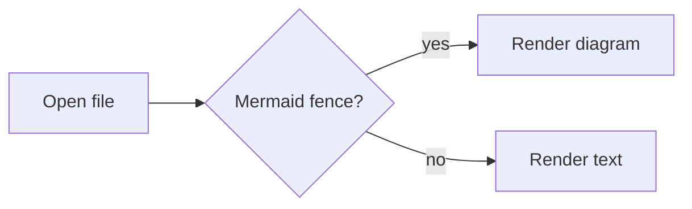
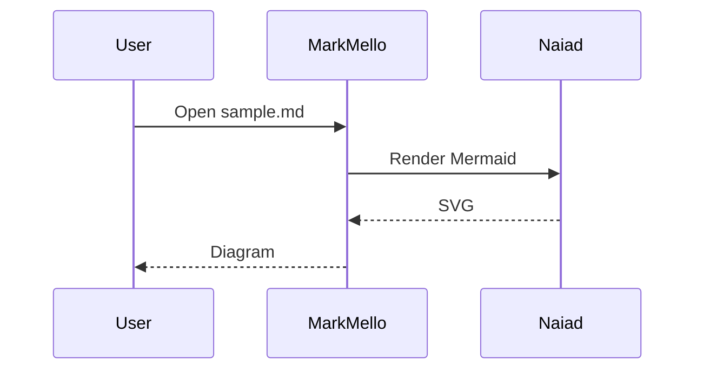
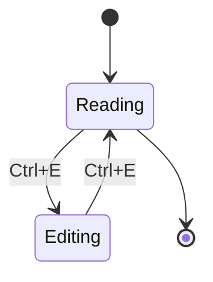

# MarkMello

> A fast, viewer-first Markdown reader for your desktop.

MarkMello opens `.md` files instantly and shows them cleanly. No workspace, no database, no cloud — just the document, centered on your screen.

---

## Why it exists

Most Markdown tools assume you want an editor, a sidebar, a project tree, and twelve panels. But most of the time you **just want to read a file** someone sent you. MarkMello is built for that moment.

- Cold start under a second
- No editor initialization until you ask for it
- Reads like a document, not a tool

## Installation

Grab the latest release for your platform:

```bash
# macOS
brew install --cask markmello

# Windows (winget)
winget install MarkMello

# Linux (AppImage)
curl -LO https://markmello.app/latest.AppImage
chmod +x latest.AppImage 
```

After install, associate `.md` files with MarkMello and you're done.

## Opening files

You can open a file three ways:

1. Double-click any `.md` in your file manager
2. Drag a file onto the MarkMello window
3. `Ctrl+O` inside the app

Command-line also works:

```pwsh
markmello README.md
```

## Reading preferences

| Setting       | Options                    | Default |
|---------------|----------------------------|---------|
| Theme         | System · Light · Dark      | System  |
| Font family   | Serif · Sans · Monospace   | Serif   |
| Column width  | Narrow · Medium · Wide     | Medium  |
| Line height   | 1.4 – 2.0                  | 1.7     |

Changes apply instantly. No restart, no reflow jank.

## Edit mode

Edit mode is deliberately behind a single action. Press `Ctrl+E` or click the edit glyph in the bottom bar to open a split view with the source on the left and the rendered preview on the right. The divider is draggable.

> Edit mode loads lazily. Until you activate it, none of the editor subsystem is in memory.

When you leave edit mode, MarkMello returns to the clean reading view it started with.

## Alerts

> [!NOTE]
> Useful information to keep in mind while reading a document.

> [!TIP]
> A helpful suggestion for completing a task more easily.

> [!IMPORTANT]
> Essential information needed to complete a task successfully.

> [!WARNING]
> Pay attention to this warning to avoid problems.

> [!CAUTION]
> An action may have unwanted consequences or cause data loss.

## Diagrams

Fenced ` ```mermaid ` blocks render inline as real diagrams — not as raw source. Rendering happens in-process; no WebView, Node, or network call.







## Math

Inline formulas render in place: the energy relation $E = mc^2$ and a small sum
$\sum_{i=1}^{n} i^2$ stay inside the paragraph.

Display formulas get their own centered block:

$$
R_{SRH} = \frac{n p - n_i^2}{\tau_p (n + n_1) + \tau_n (p + p_1)}
$$

Matrices and radicals work too:

$$
M = \begin{pmatrix} a & b \\ c & d \end{pmatrix}, \quad
\lVert v \rVert = \sqrt{x^2 + y^2}
$$

Formulas are rendered in-process; no WebView, JavaScript runtime, or network call is involved.

## Keyboard shortcuts

- `Ctrl+O` — open file
- `Ctrl+E` — toggle edit mode
- `Ctrl+,` — preferences
- `Ctrl+=` / `Ctrl+-` — zoom text
- `F11` — fullscreen reading

## Principles

MarkMello is built around a small set of rules:

1. **Viewer first.** Reading comes before editing, always.
2. **Instant open beats feature richness.** If it slows cold start, it doesn't belong in the fast path.
3. **The document is the interface.** Chrome should fade when you're not looking at it.
4. **Local-first.** No account, no sync, no network requests to read a file on your disk.
5. тест
---

*MarkMello · v1.0 · MIT License*
